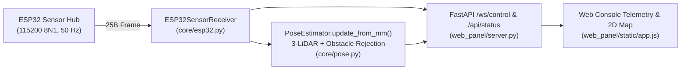

# ESP32 $\leftrightarrow$ RPi 5 UART Sensor Telemetry Plan

This document specifies the **Host-Side (RPi 5)** implementation and the **ESP32 Sender Firmware** plan for streaming sensor telemetry over **115200 baud** UART (`8N1`).

---

## 1. Physical Link & Wire Protocol

- **Baud Rate**: `115200` baud, `8N1`, no flow control
- **Default Host Device**: `/dev/ttyAMA1` (configurable via `config.ESP32.PORT` or `--esp32-port` / `--esp32-baud` CLI flags)
- **Update Rate**: `50 Hz` (`20 ms` period; `25 bytes` $\times 10\text{ bits/byte} \times 50\text{ Hz} = 12,500\text{ bps} \approx 10.9\%$ of 115200 baud capacity)
- **Framing**: Reuses the binary `Packet` / `PacketParser` framing in [comms.py](file:///home/ubuntu/TELBot-Host/core/comms.py) with CRC-8 (`0x07` polynomial, init `0x00`).

### 25-Byte Frame Layout (`<hhhIII` Payload = 18 Bytes)

| Byte Offset | Payload Offset | Field | Type (`struct`) | Units / Range | Description |
| :--- | :--- | :--- | :--- | :--- | :--- |
| `0..1` | — | `MAGIC` | `2B` | `0xAA, 0x55` | Frame sync header |
| `2` | — | `LENGTH` | `uint8_t` (`B`) | `18` (`0x12`) | Payload byte length |
| `3` | — | `SEQ` | `uint8_t` (`B`) | `0..255` | Rolling sequence counter |
| `4` | — | `CMD` | `uint8_t` (`B`) | `4` (`CmdType.TELEMETRY`) | Telemetry command ID |
| `5` | — | `PART` | `uint8_t` (`B`) | `4` (`PartType.SENSORS`) | Sensor subsystem ID |
| `6..7` | `+0..1` | `upper_rpm` | `int16_t` (`<h`) | $\text{RPM}$ | Upper flywheel measured speed |
| `8..9` | `+2..3` | `lower_rpm` | `int16_t` (`<h`) | $\text{RPM}$ | Lower flywheel measured speed |
| `10..11` | `+4..5` | `heading_deg` | `int16_t` (`<h`) | $\text{deg}$ ($0..359$ or $-180..+180$) | Earth-relative magnetic heading |
| `12..15` | `+6..9` | `dist_front_mm` | `uint32_t` (`<I`) | $\text{mm}$ (`0xFFFFFFFF` = invalid) | Front ($0^\circ$) LiDAR distance in mm (supports $12+\text{ m}$ / $1,200,000\text{ mm}$) |
| `16..19` | `+10..13` | `dist_right_mm` | `uint32_t` (`<I`) | $\text{mm}$ (`0xFFFFFFFF` = invalid) | Right ($+90^\circ$) LiDAR distance in mm (supports $12+\text{ m}$ / $1,200,000\text{ mm}$) |
| `20..23` | `+14..17` | `dist_left_mm` | `uint32_t` (`<I`) | $\text{mm}$ (`0xFFFFFFFF` = invalid) | Left ($-90^\circ$) LiDAR distance in mm (supports $12+\text{ m}$ / $1,200,000\text{ mm}$) |
| `24` | — | `CRC8` | `uint8_t` (`B`) | `0x00..0xFF` | CRC-8 (`poly=0x07`, `init=0x00`) over bytes `2..23` |

---

## 2. Host-Side Architecture (Implemented)



- **Protocol & Framing ([core/comms.py](file:///home/ubuntu/TELBot-Host/core/comms.py))**:
  - `ESP32_TELEMETRY_FMT = "<hhhIII"`, `ESP32_TELEMETRY_SIZE = 18`, `ESP32_INVALID_DIST_MM = 0xFFFFFFFF`.
  - `Packet.create_esp32_telemetry()` and `Packet.parse_telemetry()` unpack `upper_rpm`, `lower_rpm`, `heading_deg`, `dist_front_mm`, `dist_right_mm`, and `dist_left_mm` and compute `dist_front_cm`, `dist_right_cm`, and `dist_left_cm`.
- **Receiver Worker ([core/esp32.py](file:///home/ubuntu/TELBot-Host/core/esp32.py))**:
  - `ESP32SensorReceiver` runs a dedicated daemon RX thread with auto-reconnect, `PacketParser` stream decoding, staleness tracking (`STALE_TIMEOUT_S = 0.5`), and `inject_telemetry()` for testing.
- **3-LiDAR Pose Localization ([core/pose.py](file:///home/ubuntu/TELBot-Host/core/pose.py))**:
  - `PoseEstimator.update_from_mm(dist_front_mm, dist_right_mm, dist_left_mm, raw_heading_deg)` converts `mm` to `cm` and fuses Front ($0^\circ$), Right ($+90^\circ$), and Left ($-90^\circ$) beams with opposite-pair discrepancy validation and delta-based obstacle rejection.

---

## 3. ESP32 Sender Firmware Plan (To Be Implemented Later)

### 3.1 Firmware Responsibilities
1. **Flywheel Tachometers**:
   - Measure Upper and Lower flywheel speeds via GPIO pulse interrupts or hardware PCNT, converting to `int16_t` RPM (`upper_rpm`, `lower_rpm`).
2. **Geomagnetic / IMU Compass**:
   - Read earth-relative heading over $\text{I}^2\text{C}$ and normalize to integer degrees (`int16_t` `heading_deg`).
3. **3 Directional LiDAR Sensors (Front, Right, Left)**:
   - Read Front ($0^\circ$), Right ($+90^\circ$), and Left ($-90^\circ$) LiDAR distances in millimeters as `uint32_t` (`dist_front_mm`, `dist_right_mm`, `dist_left_mm`).
   - Report `0xFFFFFFFF` if a sensor times out or is out of range.
4. **50 Hz Non-Blocking UART Transmitter**:
   - Every `20 ms`, pack the 25-byte frame and write it over `Serial1` (`115200` baud, `8N1`) to the RPi 5 Host:

```cpp
// Reference ESP32 Frame Serializer (25 bytes total)
uint8_t crc8_0x07(const uint8_t* data, size_t len) {
    uint8_t crc = 0x00;
    for (size_t i = 0; i < len; ++i) {
        crc ^= data[i];
        for (uint8_t b = 0; b < 8; ++b) {
            crc = (crc & 0x80) ? ((crc << 1) ^ 0x07) : (crc << 1);
        }
    }
    return crc;
}

void send_telemetry_frame(
    HardwareSerial& port,
    uint8_t seq,
    int16_t upper_rpm,
    int16_t lower_rpm,
    int16_t heading_deg,
    uint32_t dist_front_mm,
    uint32_t dist_right_mm,
    uint32_t dist_left_mm
) {
    uint8_t buf[25];
    buf[0] = 0xAA;
    buf[1] = 0x55;
    buf[2] = 18; // Payload length (<hhhIII = 18 bytes)
    buf[3] = seq;
    buf[4] = 4;  // CmdType::TELEMETRY
    buf[5] = 4;  // PartType::SENSORS

    // Little-endian payload packing
    memcpy(&buf[6],  &upper_rpm,     2);
    memcpy(&buf[8],  &lower_rpm,     2);
    memcpy(&buf[10], &heading_deg,   2);
    memcpy(&buf[12], &dist_front_mm, 4);
    memcpy(&buf[16], &dist_right_mm, 4);
    memcpy(&buf[20], &dist_left_mm,  4);

    buf[24] = crc8_0x07(&buf[2], 22); // CRC over bytes 2..23
    port.write(buf, sizeof(buf));
}
```
