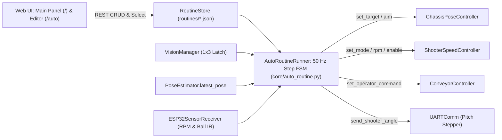

# Autonomous Routine Storage, 50 Hz Runner & Web UI Editor Implementation Plan

**Status**: Implemented & Verified  
**Target Components**: `config.py`, `core/auto_routine.py`, `core/__init__.py`, `routines/`, `main.py`, `web_panel/server.py`, `web_panel/index.html`, `web_panel/static/app.js`, `web_panel/auto_editor.html`, `web_panel/static/auto_editor.js`, `web_panel/static/style.css`, [AGENTS.md](../AGENTS.md)

---

## 1. Overview & Goals

Implement an autonomous routine storage system, a non-blocking 50 Hz Host sequence runner (`AutoRoutineRunner` + `step_auto_routine`), and a **two-page Web UI architecture** consisting of:
- **Live progress & routine selector on the Main Operator Panel** (`GET /`), keeping the zero-scroll single-screen layout and WebHID gamepad session uninterrupted.
- **A dedicated full-page Interactive Auto Routine Editor** (`GET /auto`), featuring a `400 × 500 cm` interactive 2D waypoint planner canvas and step sequence builder backed by structured JSON files (`routines/*.json`) on the Host.

During the 1:00 `AUTO` phase (or `PRACTICE` test runs), `AutoRoutineRunner` orchestrates existing closed-loop Host controllers:
- `ChassisPoseController` (`core/control.py`) for P2P field navigation and goal aiming.
- `ShooterSpeedController` (`core/control.py`) for dual flywheel RPM spin-up (auto-distance or manual).
- `ConveyorController` (`core/control.py`) for ball feeding with IR-based anti-jam auto-reverse and ball counting.
- `VisionManager` (`core/vision.py`) for 1×3 special goal latching (`left`, `center`, `right`).
- `UARTComm` (`core/comms.py`) for pitch stepper actuation (`TB6560`).



---

## 2. Confirmed Design Decisions

1. **Two-Page Web UI Split (`/` vs. `/auto`)**:
   - **Why Separate Pages**: Keeping the WebHID (`navigator.hid`) controller stream and `/ws/control` loop isolated on the Main Operator Console (`/`) guarantees that authoring or tweaking autonomous routines in a second tab (`/auto`) never clutters the single-screen dashboard or interrupts an active gamepad connection.
   - **Shared Real-Time Backend State**: Both pages synchronize through the same FastAPI server (`web_panel/server.py`). Saving or activating a routine in `/auto` immediately updates the Main Panel's dropdown and 2D waypoint preview, and 50 Hz runner progress streams live to both pages.
   - **Main Operator Console (`GET /` $\to$ `web_panel/index.html`)**:
     - Adds an **Active Routine Selector** (`#match-auto-routine-select`), a **Live Routine Progress Chip** (`#auto-runner-chip`, e.g., `Auto: Idle`, `Step 2/4: Drive (1.8s / 5.0s)`, `Step 3/4: Feed (1/2)`, `Auto: Completed`), a quick **`Abort Auto`** button when active, and an **`Auto Editor`** link button (`target="_blank"` opening `/auto`) in the Match Bar.
     - Draws the active routine's planned waypoint polyline (`start_pose -> step waypoints`) with numbered markers on `#field-map-canvas` behind the live robot pose.
   - **Dedicated Auto Routine Editor (`GET /auto` $\to$ `web_panel/auto_editor.html` + `web_panel/static/auto_editor.js`)**:
     - Full-viewport 2-column layout sharing the Material You / BeerCSS dark & light theme (`web_panel/static/style.css`).
     - Left column: interactive `400 × 500 cm` 2D field planner canvas (click/drag waypoints, start pose marker, `25 cm` wall-margin boundary, top-wall 3×3 & 1×3 targets, aim-sight lines, and live robot pose overlay).
     - Right column: routine CRUD toolbar (`New`, `Duplicate`, `Save`, `Set Active`, `Delete`, `Import JSON`, `Export JSON`), Practice test runner bar (`Switch to Practice & Run`, `Abort`, live step readout), routine metadata & start pose inputs, step palette, and reorderable step cards.

2. **Match Mode Gating & Safety Policy (`core/match.py`)**:
   - **Automatic Start on `AUTO`**: `POST /api/match/auto/start` resets `VisionManager`, transitions `MatchManager` to `MatchMode.AUTO`, and automatically starts `AutoRoutineRunner` using the currently active routine.
   - **Hard 1:00 (`60.0 s`) Autonomous Cutoff**: When `MatchManager.mode == MatchMode.AUTO` and `phase_time_remaining <= 0.0` (or `match_manager.mode` leaves `(AUTO, PRACTICE)`), `step_auto_routine()` immediately aborts any running routine, stops `ChassisPoseController`, `ShooterSpeedController`, `ConveyorController`, and pitch stepper, and triggers `uart.send_stop()` as `MatchManager` enters `AUTO_WAIT`.
   - **Practice-Mode Testing (`POST /api/auto/run`)**:
     - Permitted only in `MatchMode.PRACTICE` (and `MatchMode.AUTO`). Rejected with HTTP `423 Locked` in `DISARMED`, `TELEOP`, `AUTO_WAIT`, and `MATCH_OVER`.
   - **Instant Driver Preemption in `PRACTICE`**:
     - While `AutoRoutineRunner.is_running` is `True` in `MatchMode.PRACTICE`, any non-zero manual drive command (`vx != 0 or vy != 0 or omega != 0`) arriving via `POST /api/drive` or `/ws/control` (`"drive"`) immediately calls `auto_runner.abort("Preempted by manual driver input")` and stops `ChassisPoseController`, returning full control to the operator.
     - Centered-stick `(0, 0, 0)` drive keep-alives and idle gamepad packets (`flywheel == 0`, `trigger == 0`, `spinner_run == False`, `angle_run == False`) sent by `web_panel/static/app.js` are ignored while `auto_runner.is_running` is `True` so a connected idle gamepad does not overwrite active autonomous steps.
   - **Immediate Fault / Stop Abort**:
     - Hardware E-Stop, Web E-Stop, `POST /api/stop`, `/ws/control` `"stop"`, `POST /api/match/disarm`, `POST /api/match/reset`, or switching to `MatchMode.TELEOP` immediately aborts `AutoRoutineRunner` and zeroes all actuators.

3. **Persistence & File Safety (`routines/`)**:
   - Each routine is stored as an individual human-readable JSON file (`routines/<routine_id>.json`), with the active competition selection stored in `routines/_active.json`.
   - Routine IDs are validated against `^[a-zA-Z0-9_-]{1,64}$` (rejecting path traversal, slashes, or `_active`) and all coordinates/parameters are validated and clamped on load and save.

---

## 3. JSON Routine Schema & Step Primitives

### 3.1 Routine JSON Document (`routines/<routine_id>.json`)
```json
{
  "id": "default_1x3_auto",
  "name": "1x3 Active Goal (2 Balls) + Center Follow-up",
  "description": "Waits for YOLO 1x3 latch, drives to midfield shooting pose while pre-spinning flywheels, feeds 2 balls, and stops.",
  "start_pose": {
    "x_cm": 200.0,
    "y_cm": 80.0,
    "heading_deg": 0.0
  },
  "updated_at": 1795116000.0,
  "steps": [
    {
      "id": "step_1",
      "type": "wait_vision",
      "label": "Wait for YOLO 1x3 Latch",
      "timeout_s": 2.0,
      "fallback_target": "center"
    },
    {
      "id": "step_2",
      "type": "drive_to",
      "label": "Drive to Midfield Shooting Spot",
      "x_cm": 200.0,
      "y_cm": 260.0,
      "aim_mode": "active_1x3",
      "heading_deg": 0.0,
      "goal_column": "center",
      "stop_on_arrival": true,
      "pre_spin_shooter": true,
      "shooter_mode": "auto",
      "shooter_rpm": 3900.0,
      "timeout_s": 5.0
    },
    {
      "id": "step_3",
      "type": "feed_balls",
      "label": "Shoot 2 Balls into Active 1x3",
      "trigger_speed": 700,
      "spinner_run": true,
      "require_at_speed": true,
      "at_speed_timeout_s": 1.5,
      "ball_count": 2,
      "duration_s": 2.5
    },
    {
      "id": "step_4",
      "type": "stop_all",
      "label": "Safe Stop"
    }
  ]
}
```

### 3.2 Supported Step Primitives (`AutoStepType`)

| Step Type | Purpose | Parameters & Bounds | Completion / Advancement Rule |
| :--- | :--- | :--- | :--- |
| `wait_vision` | Wait for laptop YOLO to latch the active 1×3 goal via `/api/vision/target`. | `timeout_s` (`0.1..15.0`), `fallback_target` (`"left" \| "center" \| "right"`) | Advances immediately when `vision_manager.latest_target.latched == True`. On timeout, forces `vision_manager.update(fallback_target, True, force=True)` so subsequent `active_1x3` steps have a deterministic goal. |
| `drive_to` | Closed-loop 3-DOF P2P move using `ChassisPoseController`, with optional parallel flywheel pre-spin. | `x_cm` (`[25, 375]`), `y_cm` (`[25, 475]`), `aim_mode` (`"explicit" \| "active_1x3" \| "column"`), `heading_deg` (`0..359`), `goal_column` (`"left" \| "center" \| "right"`), `stop_on_arrival` (`bool`), `pre_spin_shooter` (`bool`), `shooter_mode` (`"auto" \| "manual"`), `shooter_rpm` (`0..5500`), `timeout_s` (`0.2..30.0`) | On step entry: resolves goal coordinates (if `aim_mode != "explicit"`) and calls `chassis_controller.set_target(...)` or `set_target_aim_at_goal(...)`; if `pre_spin_shooter`, configures and enables `ShooterSpeedController`. Advances when `chassis_controller.is_at_target()` is `True`, or stops chassis on `elapsed >= timeout_s`. |
| `aim_at` | Rotate in place at current robot `(x_cm, y_cm)` to face an explicit heading or goal column. | `aim_mode` (`"explicit" \| "active_1x3" \| "column"`), `heading_deg`, `goal_column`, `stop_on_arrival` (`bool`), `timeout_s` (`0.2..15.0`) | Latches current `pose.x_cm, pose.y_cm` at step entry (or aborts/skips safely if pose missing) and commands `ChassisPoseController` heading target. Advances when `chassis_controller.is_at_target()` or `elapsed >= timeout_s`. |
| `shooter_set` | Enable, adjust mode/RPM, or stop dual flywheels via `ShooterSpeedController`. | `enabled` (`bool`), `mode` (`"auto" \| "manual"`), `target_rpm` (`0..5500`), `wait_at_speed` (`bool`), `timeout_s` (`0.1..15.0`) | Configures `ShooterSpeedController`. If `not enabled` or `not wait_at_speed`, advances immediately. If `wait_at_speed`: advances when `shooter_controller.is_at_speed()` (or after `AutoRoutine.OPEN_LOOP_SPINUP_WAIT_S` if ESP32 telemetry is offline/stale) or `elapsed >= timeout_s`. |
| `pitch_step` | Pulse shooter hood pitch stepper (`TB6560`) up/down or disable driver. | `action` (`"up" \| "down" \| "disable"`), `duration_s` (`0.05..5.0`) | If `"disable"`, calls `uart.send_shooter_disable_angle()` and advances immediately. If `"up"`/`"down"`, sends `uart.send_shooter_angle(run=True, reversed=(action=="down"))` for `duration_s`, then stops stepper (`run=False`) and advances. |
| `feed_balls` | Run conveyor trigger & spinner (with `ConveyorController` anti-jam auto-reverse) to launch balls. | `trigger_speed` (`-1000..1000`), `spinner_run` (`bool`), `require_at_speed` (`bool`), `at_speed_timeout_s` (`0.0..5.0`), `ball_count` (`0..10`, `0` = timed only), `duration_s` (`0.1..15.0`) | Phase 1: if `require_at_speed`, holds conveyor idle until `shooter_controller.is_at_speed()` (or `OPEN_LOOP_SPINUP_WAIT_S` in open-loop) or `at_speed_timeout_s` elapses. Phase 2: sets `conveyor_controller.set_operator_command(trigger_speed, spinner_run, False)` and sends `uart.send_conveyor_command(...)`. Counts ESP32 IR `ball_detected` `True -> False` falling edges; advances when `balls_fed >= ball_count` (if `ball_count > 0` and ESP32 fresh) or `feed_elapsed >= duration_s`, then zeroes conveyor. |
| `wait` | Fixed dwell pause. | `duration_s` (`0.05..30.0`) | Advances when `elapsed >= duration_s`. |
| `stop_all` | Safe halt of all motion subsystems. | *(none)* | Stops chassis, shooter, conveyor, and pitch stepper (`uart.send_stop()`) and advances immediately. |

---

## 4. File-by-File Implementation Blueprint

### Step 1: `config.py`
Add `class AutoRoutine` after `ChassisPID`:
```python
class AutoRoutine:
    """Autonomous routine storage and 50 Hz sequence runner configuration."""

    ROUTINES_DIR = "routines"
    ACTIVE_STATE_FILE = "_active.json"
    DEFAULT_ROUTINE_ID = "default_1x3_auto"
    MAX_STEPS = 32
    MAX_ROUTINE_DURATION_S = 60.0
    OPEN_LOOP_SPINUP_WAIT_S = 0.6  # Fallback spin-up wait when ESP32 RPM telemetry is offline
```

### Step 2: `core/auto_routine.py` and `core/__init__.py`
Create `core/auto_routine.py` implementing:
1. **`AutoStepType` (`str, Enum`)**: `wait_vision`, `drive_to`, `aim_at`, `shooter_set`, `pitch_step`, `feed_balls`, `wait`, `stop_all`.
2. **`AutoStep` & `AutoRoutineDefinition` dataclasses**:
   - Strict field validation & wall-margin clamping (`[ChassisPID.WALL_MARGIN_CM, Field.WIDTH_CM - WALL_MARGIN_CM]` × `[ChassisPID.WALL_MARGIN_CM, Field.LENGTH_CM - WALL_MARGIN_CM]`).
   - ID slug validation (`^[a-zA-Z0-9_-]{1,64}$`, disallowing `"_active"`).
   - `estimated_duration_s()` summing step timeouts/durations (and warning in the UI if > 60.0 s).
   - `to_dict()` / `from_dict()` JSON round-tripping.
3. **`RoutineStore`**:
   - Thread-safe (`threading.RLock`) persistence in `<ROOT_DIR>/routines/`.
   - Seeds 2 default starter routines (`default_1x3_auto.json`, `left_flank_1x3_auto.json`) on startup if the directory has no routine JSON files.
   - Persists active routine selection in `routines/_active.json`.
   - Public API: `list_routines()`, `get_routine(routine_id)`, `save_routine(data)`, `delete_routine(routine_id)`, `set_active_routine(routine_id)`, `get_active_routine()`.
4. **`AutoRoutineRunnerState` & `AutoRoutineRunner`**:
   - Thread-safe (`threading.RLock`) 50 Hz finite-state machine coordinating `ChassisPoseController`, `ShooterSpeedController`, `ConveyorController`, `VisionManager`, and `UARTComm`.
   - Tracks `running`, `status` (`"idle" | "running" | "completed" | "aborted" | "error"`), `status_message`, `routine_id`, `routine_name`, `current_step_index`, `total_steps`, `current_step_id`, `current_step_type`, `current_step_label`, `step_elapsed_s`, `step_timeout_s`, `routine_elapsed_s`, `balls_fed_in_step`, `resolved_goal_column`, `steps_summary`.
   - Public API: `start(routine=None, now=None)`, `abort(reason="Aborted by operator")`, `update(...)`, `get_status()`, `is_running`.
5. **`step_auto_routine(...)`**:
   - Signature:
     `step_auto_routine(runner, uart, match_manager, pose_estimator, vision_manager, esp32_receiver, chassis_controller, shooter_controller, conveyor_controller, now=None) -> dict`
   - Executed at 50 Hz **before** `step_shooter_control`, `step_conveyor_control`, and `step_chassis_control`.
   - Enforces E-Stop, `MatchMode.AUTO` / `MatchMode.PRACTICE` gating, and the 60.0 s `Match.AUTO_DURATION_S` hard cutoff.
6. Export `AutoRoutineDefinition`, `AutoRoutineRunner`, `AutoRoutineRunnerState`, `AutoStep`, `AutoStepType`, `RoutineStore`, and `step_auto_routine` in `core/__init__.py`.

### Step 3: `main.py`
1. Import `AutoRoutineRunner`, `RoutineStore`, `step_auto_routine` from `core`, plus `set_auto_runner` and `set_routine_store` from `web_panel.server`.
2. Instantiate `self.routine_store = RoutineStore()` and `self.auto_runner = AutoRoutineRunner(self.routine_store)` in `RobotHost.__init__`.
3. Call `self.auto_runner.abort(...)` in `_handle_match_stop()`, `_handle_estop_press()`, and `RobotHost.run()`'s `finally:` block.
4. Inject `set_routine_store(self.routine_store)` and `set_auto_runner(self.auto_runner)` in `RobotHost.run()`.
5. In `_safety_and_heartbeat_loop()`, run `step_auto_routine(...)` immediately after `self.match_manager.tick()` and before `step_shooter_control`, `step_conveyor_control`, and `step_chassis_control`.

### Step 4: `web_panel/server.py`
1. Instantiate module-level `routine_store = RoutineStore()` and `auto_runner = AutoRoutineRunner(routine_store)` with `set_routine_store`/`get_routine_store` and `set_auto_runner`/`get_auto_runner`.
2. Wire `get_auto_runner().abort(...)` into `_on_match_stop_with_comm` and standalone `lifespan` shutdown, and call `step_auto_routine(...)` in `_standalone_shooter_pid_loop()`.
3. Include `"auto_routine": get_auto_runner().get_status()` in `_build_combined_telemetry()`, `GET /api/status`, and `/ws/control` responses.
4. **Update `POST /api/match/auto/start`**:
   - Reset `VisionManager`, call `get_match_manager().start_auto()`, and start `get_auto_runner().start()` with the active routine (returning `"auto_routine"` alongside match status).
5. **Driver Preemption & Idle Gamepad Guard**:
   - In `POST /api/drive` and `/ws/control` (`"drive"`): when `get_auto_runner().is_running`, non-zero drive input immediately calls `get_auto_runner().abort("Preempted by manual driver input")` and stops `ChassisPoseController`; centered `(0, 0, 0)` idle drive packets are ignored while `auto_runner.is_running`.
   - In `/ws/control` (`"shooter"`, `"conveyor"`): ignore idle all-zero keep-alives (`flywheel == 0 and not angle_run`, `trigger == 0 and not spinner_run`) while `auto_runner.is_running`.
   - In `POST /api/stop` and `/ws/control` (`"stop"`): abort `get_auto_runner()` whenever `part == PartType.ALL`.
6. **New Page & REST Endpoints**:
   - `GET /auto`: serves `web_panel/auto_editor.html`.
   - `GET /api/auto/routines`: returns `active_routine_id`, `routines` metadata list, and `runner` status.
   - `GET /api/auto/routines/{routine_id}`: returns full routine JSON definition (`404` if not found).
   - `POST /api/auto/routines`: validates and saves routine JSON (`400` on invalid payload).
   - `DELETE /api/auto/routines/{routine_id}`: deletes routine (`400` if attempting to delete the last remaining routine or currently running routine).
   - `POST /api/auto/active`: sets active routine ID (`{"routine_id": "..."}`) persisted in `routines/_active.json`.
   - `POST /api/auto/run`: starts active (or specified `routine_id`) routine immediately; gated to `MatchMode.PRACTICE` or `MatchMode.AUTO` (`423 Locked` otherwise).
   - `POST /api/auto/abort`: aborts running routine and zeroes all controllers.

### Step 5: Main Operator Panel Updates (`web_panel/index.html`, `web_panel/static/app.js`, `web_panel/static/style.css`)
1. **Match Phase Bar (`web_panel/index.html`)**:
   - Add `#match-auto-routine-select` dropdown (choosing the routine that runs on `Start Auto`), `#auto-runner-chip` live step progress badge, `#match-auto-abort-btn` (visible when `auto_routine.running` is `true`), and `<a href="/auto" target="_blank" ...>Auto Editor</a>` button.
2. **Telemetry & Path Overlay (`web_panel/static/app.js`)**:
   - Track `latestAutoRoutineState` from `/ws/control` and `/api/status`, plus fetch `/api/auto/routines` (on load and when active routine ID/timestamp changes) to populate `#match-auto-routine-select` and cache the active routine's waypoints (`activeRoutineDefinition`).
   - Update `#auto-runner-chip` (`Auto: Idle` / `Step X/Y: <label> (elapsed/timeout)` / `Auto: Completed` / `Auto: Aborted`) and `#match-status-msg` during `MatchMode.AUTO`.
   - In `drawFieldMap(pose)`: render the active routine's planned path (`start_pose -> step waypoints`) as a subtle dashed amber/indigo polyline with numbered waypoint dots, highlighting the currently executing step index.

### Step 6: Dedicated Auto Routine Editor Page (`web_panel/auto_editor.html`, `web_panel/static/auto_editor.js`, `web_panel/static/style.css`)
1. **`web_panel/auto_editor.html`**:
   - Standalone BeerCSS Material You HTML page linking `/static/beer.min.css`, `/static/style.css`, `/static/beer.min.js`, and `/static/auto_editor.js`.
   - **Top Bar**: Title, live runner status chip (`#editor-runner-chip`), WS/polling sync indicator, theme toggle, `Back to Console (/)` link, and `STOP ALL` emergency button.
   - **Routine Toolbar**: Routine selector (`#editor-routine-select`), `New`, `Duplicate`, `Save`, `Set Active for Auto`, `Delete`, `Import JSON`, `Export JSON`, plus Practice test controls (`Test Run in Practice`, `Abort`).
   - **Left Column (`s12 l5`) — 2D Field Planner Canvas (`#auto-editor-canvas`, `400 × 500`)**:
     - Click/drag mode toggle (`Select & Drag Waypoints` vs. `Click Map to Add Drive Step`), snap-to-5cm toggle, live robot pose overlay toggle, and canvas coordinate cursor readout `(X, Y)`.
     - Draws field grid, `25 cm` wall-margin box, 3×3 & 1×3 top-wall goals, green `START` pose marker, numbered waypoint nodes, directional path arrows, aim-sight vectors, and selected-step highlight halo.
   - **Right Column (`s12 l7`) — Metadata & Step Sequence Builder**:
     - Routine Name, ID slug, Description, Start Pose `(X, Y, Heading)`, and Estimated Duration badge (`Est: XX.Xs / 60.0s`, warning if `> 60.0s`).
     - Quick-Add Step Palette (`+ Wait Vision`, `+ Drive To`, `+ Aim At`, `+ Shooter Set`, `+ Pitch Step`, `+ Feed Balls`, `+ Wait`, `+ Stop All`).
     - Reorderable step cards (`↑`, `↓`, `Duplicate`, `Delete`, collapse/expand) with type-specific form controls and active-step execution highlighting (`step-card-running`).
2. **`web_panel/static/auto_editor.js`**:
   - Manages routine CRUD via `/api/auto/routines`, `/api/auto/active`, `/api/auto/run`, `/api/auto/abort`, `/api/match/practice/start`, and `/api/stop`.
   - Polls `/api/status` (250 ms while running, 1000 ms while idle) so live robot pose and step execution progress update smoothly on the planner canvas and step list.
   - Handles canvas pointer drag/hit-testing for start pose and `drive_to` waypoints, dirty-state indicator (`Unsaved changes`), and JSON file import/export (`Blob` download + `<input type="file">`).

---

## 5. Verification & Bench-Test Checklist

### 5.1 Automated Unit & 50 Hz Simulation Tests (`core/auto_routine.py`)
1. **Schema & Store Persistence**: Test routine serialization, wall-margin clamping, invalid ID / path-traversal rejection, `RoutineStore` default seeding, CRUD operations, and `_active.json` persistence in a `tempfile.TemporaryDirectory()`.
2. **50 Hz Multi-Step Closed-Loop Simulation**:
   - Simulate a 4-step routine (`wait_vision` $\to$ `drive_to` with `pre_spin_shooter=True` $\to$ `feed_balls` with `ball_count=2` $\to$ `stop_all`) against `PoseEstimator`, `ChassisPoseController`, `ShooterSpeedController`, `ConveyorController`, `VisionManager`, and `ESP32SensorReceiver` with a dry-run `UARTComm`.
   - Verify `wait_vision` advances on YOLO latch (and falls back on timeout), `drive_to` converges using the 2D holonomic plant, `feed_balls` counts 2 falling edges on `ball_detected` (`True -> False`) and exits early, and `stop_all` zeroes all subsystems.
3. **Safety & Match Gating**:
   - Verify `step_auto_routine` aborts immediately on `uart.estop_active`, `MatchMode.TELEOP` / `DISARMED` / `AUTO_WAIT`, and when `MatchManager` 60.0 s Auto timer expires.

### 5.2 CLI & Server Verification
- `.venv/bin/python core/auto_routine.py`
- `.venv/bin/python core/control.py`
- `.venv/bin/python -m py_compile config.py core/auto_routine.py core/__init__.py main.py web_panel/server.py`
- Direct FastAPI endpoint tests for `GET /auto`, `/api/auto/routines` CRUD, `/api/auto/active`, `/api/auto/run` (423 mode lock + Practice execution), `/api/match/auto/start` auto-launch, and `/api/drive` driver preemption.
- Browser UI walkthrough on `/` and `/auto` verifying canvas waypoint dragging, save/reload persistence, Practice test execution, live progress synchronization on `/`, and manual driver preemption.

---

## 6. Physical Robot Bring-Up (Safety Sequence)
1. **Dry-Run / Wheels-Off-Ground Test**: Run the default routine in `PRACTICE` with robot on blocks, feed simulated or live pose/vision states, and verify step transitions, flywheel spin-up, pitch pulse direction, and conveyor feed timing.
2. **Practice Floor Test**: Author a 2-waypoint test routine in `/auto`, switch to `PRACTICE`, run `Test Run in Practice`, and verify instant driver preemption by nudging a WebHID gamepad stick mid-routine.
3. **Full 1:00 `AUTO` Simulation**: Activate the competition routine, place robot at `start_pose`, trigger `Start Auto (1:00)`, send a `/api/vision/target` detection, and verify automatic completion + motor halt into `AUTO_WAIT`.
