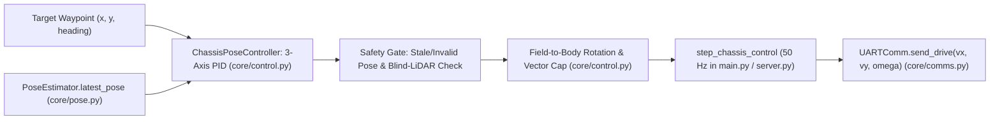

# Chassis Pose-to-Point (P2P) PID Controller Implementation Plan

**Status**: Planned (Not Yet Implemented)  
**Target Components**: `config.py`, `core/pose.py`, `core/control.py`, `core/__init__.py`, `main.py`, `web_panel/server.py`, `web_panel/index.html`, `web_panel/static/app.js`, `web_panel/static/style.css`, [AGENTS.md](../AGENTS.md)

---

## 1. Overview & Goals

Implement a closed-loop 3-DOF holonomic Pose-to-Point (P2P) PID controller (`ChassisPoseController`) and a 50 Hz host step function (`step_chassis_control`) that drives the Mecanum chassis to a target field pose `(target_x_cm, target_y_cm, target_heading_deg)` using:
- Live field pose `(x_cm, y_cm, heading_deg)` from `PoseEstimator` (`core/pose.py`, fused from compass and 3 directional LiDARs streamed from ESP32; see [ESP32.md](ESP32.md)).
- Three decoupled `PIDController` instances (`core/pid.py`) for field $X$, field $Y$, and field heading $\theta$.
- Existing UART drive framing (`UARTComm.send_drive(vx, vy, omega)` in `core/comms.py`) to Pico W (`slave/lib/subsystems/chassis.py`).



---

## 2. Confirmed Design Decisions

1. **Match Mode Access Policy (`core/match.py`)**:
   - `POST /api/chassis/goto` and Web UI waypoint triggers are **only permitted in `MatchMode.PRACTICE`** (reject with HTTP `423 Locked` in `TELEOP`, `AUTO`, `DISARMED`, `AUTO_WAIT`, and `MATCH_OVER`).
   - During `MatchMode.AUTO`, remote operator endpoints remain locked out per competition rules; only internal Host autonomous routine steps (built via a future Web UI editor / Host routine runner) invoke `chassis_controller.set_target(...)` directly.
   - `step_chassis_control()` actively outputs drive commands **only in `MatchMode.AUTO` and `MatchMode.PRACTICE`** when `not uart.estop_active`. In `TELEOP`, `DISARMED`, `AUTO_WAIT`, `MATCH_OVER`, or E-Stop, it immediately disables `ChassisPoseController`, resets PIDs, and sends `(0, 0, 0)` if previously active.
   - **Driver Preemption in `PRACTICE`**: Any non-zero manual drive command (`vx != 0 or vy != 0 or omega != 0`) arriving via `/ws/control` (`"drive"`) or `POST /api/drive` immediately cancels `ChassisPoseController` (`stop()`) and executes the manual drive command. Centered-stick `(0, 0, 0)` WebSocket keep-alive packets sent by `web_panel/static/app.js` while a gamepad is idle are ignored whenever `chassis_controller.enabled` is `True`.

2. **Blind-LiDAR Rotation Policy**:
   - In `core/pose.py`, `PoseSensor.MAX_RAY_INCIDENCE_DEG = 35.0` causes LiDAR wall projections to temporarily report `no_valid_beam` when the robot rotates through diagonal headings (e.g., $35^\circ\text{–}55^\circ$), freezing `(x_cm, y_cm)` while compass `heading_deg` remains live. Obstacles can also trigger `rejected_delta`, `right_rejected_delta`, or `left_rejected_delta`.
   - **Policy**: Track how long the translation axes have been blind (`no_valid_beam` or `*_rejected*`). If blind continuously for more than `MAX_BLIND_HOLD_S` (`0.25 s`), **pause translation** ($u_X = 0, u_Y = 0$, reset `x_pid` and `y_pid`) while **continuing to run `heading_pid` ($\omega$)** so the robot can finish rotating back onto valid wall angles instead of deadlocking.
   - If the entire pose is missing (`pose is None`), invalid (`not pose.valid` or `x_cm is None` or `y_cm is None`), or stale (`age > POSE_STALE_TIMEOUT_S = 0.5 s`), immediately output `(0, 0, 0)` and reset all 3 PIDs.

3. **Default Arrival Behavior (`stop_on_arrival = True`)**:
   - `stop_on_arrival` defaults to **`True`** in `set_target()`, `set_target_aim_at_goal()`, and `POST /api/chassis/goto`.
   - Once position error and heading error stay continuously within tolerance for `SETTLE_TIME_S` (`0.20 s`), `at_target` becomes `True`, `enabled` automatically clears to `False`, and `(0, 0, 0)` is sent so the chassis stops and relaxes.
   - Autonomous routines or callers that want active station-keeping (e.g., holding pose during ball feeding) can explicitly pass `stop_on_arrival=False`.

---

## 3. Verified Coordinate System & Mecanum Sign Conventions

### 3.1 Field Coordinate Frame (`core/pose.py`)
- Origin `(0, 0)` at bottom-left corner of the `400 cm × 500 cm` field.
- $+X \in [0.0, 400.0]\text{ cm}$: Left $\to$ Right.
- $+Y \in [0.0, 500.0]\text{ cm}$: Bottom $\to$ Top (toward the 3x3 target grid and special 1x3 row at $y = 500\text{ cm}$).
- Field heading $\theta \in [0^\circ, 360^\circ)$ (`PoseSensor.CLOCKWISE_HEADING = True`):
  - $0^\circ$ faces $+Y$ (Top wall), $90^\circ$ faces $+X$ (Right wall), $180^\circ$ faces $-Y$, $270^\circ$ faces $-X$.
  - Forward unit vector: $\hat{f}(\theta) = (\sin\theta, \cos\theta)$.
  - Rightward unit vector: $\hat{r}(\theta) = (\cos\theta, -\sin\theta)$.

### 3.2 Host UART $\leftrightarrow$ Pico W Mecanum Kinematics
Verified in `core/comms.py`, `slave/lib/comms/communicator.py` (line 108), and `slave/lib/subsystems/chassis.py` (lines 51–89):
- Host sends `Packet.create_chassis_drive(vx, vy, omega)` with integer scaling `[-1000, +1000]`:
  - `vx` $\to$ `chassis.drive(y_speed=vx/1000, ...)` $\to$ `+vx` moves **Forward** along $\hat{f}(\theta)$.
  - `vy` $\to$ `chassis.drive(..., x_speed=vy/1000)` $\to$ `+vy` strafes **Right** along $\hat{r}(\theta)$.
  - `omega` $\to$ `chassis.drive(..., z_rotation=omega/1000)` $\to$ `lf = y_c + x_c + z`, `lr = y_c - x_c + z`, `rf = y_c - x_c - z`, `rr = y_c + x_c - z` $\to$ `+omega` rotates **Clockwise** (increasing $\theta$).

### 3.3 Control Equations
1. **Axis Errors**:
   - $e_x = x_{\text{target}} - x_{\text{cm}}$
   - $e_y = y_{\text{target}} - y_{\text{cm}}$
   - $e_\theta = \operatorname{wrap}(\theta_{\text{target}} - \theta_{\text{deg}}) \in [-180^\circ, +180^\circ)$
2. **Field Velocities & Direction-Preserving Vector Cap**:
   - Compute $u_X = \text{x\_pid.update}(x_{\text{target}}, x_{\text{cm}})$, $u_Y = \text{y\_pid.update}(y_{\text{target}}, y_{\text{cm}})$, $\omega = \text{heading\_pid.update}(\theta_{\text{target}}, \theta_{\text{deg}})$.
   - Compute translational magnitude $\|u\| = \sqrt{u_X^2 + u_Y^2}$. If $\|u\| > v_{\max}$ (`MAX_LINEAR_SPEED`), scale **both** $u_X$ and $u_Y$ uniformly by $v_{\max} / \|u\|$ so diagonal travel direction is preserved without per-axis clipping distortion.
   - Clamp $\omega$ to $[-\omega_{\max}, +\omega_{\max}]$ (`MAX_ANGULAR_SPEED`).
3. **Optional Stiction Floor (Static Friction Compensation)**:
   - Applied *outside* `PIDController` (directed along output, never using `sgn(setpoint)`), and only when outside tolerance and output is non-zero:
     - If $0 < \|u\| < u_{\min}$ (`MIN_LINEAR_CMD`, default `0.0`), scale $(u_X, u_Y)$ radially up to magnitude $u_{\min}$.
     - If $0 < |\omega| < \omega_{\min}$ (`MIN_ANGULAR_CMD`, default `0.0`), raise $|\omega|$ to $\omega_{\min}$ preserving sign.
4. **Field-to-Body Velocity Rotation**:
   $$v_x = u_Y \cos\theta + u_X \sin\theta, \qquad v_y = u_X \cos\theta - u_Y \sin\theta$$
   Since $\|(u_X, u_Y)\| \le v_{\max} \le 1000$, rotation preserves Euclidean norm so $|v_x|, |v_y| \le v_{\max} \le 1000$.
   - Quick sign check:
     - $\theta = 0^\circ$: $v_x = u_Y$ (North = Forward), $v_y = u_X$ (East = Strafe Right).
     - $\theta = 90^\circ$: $v_x = u_X$ (East = Forward), $v_y = -u_Y$ (North = Strafe Left).
     - $\theta = 180^\circ$: $v_x = -u_Y$, $v_y = -u_X$.
     - $\theta = 270^\circ$: $v_x = -u_X$, $v_y = u_Y$.

---

## 4. Critical `PIDController` Configuration Pitfalls (`core/pid.py`)

Any agent implementing `ChassisPoseController` must heed these exact behaviors of `core/pid.py`:

1. **`kv = 0.0` and `ks = 0.0` on all 3 PIDs**:
   In `PIDController.update()` (`core/pid.py` line 308), feedforward is `kv * setpoint + ks * sgn(setpoint)`. That is designed for velocity loops (like flywheel RPM), **not** coordinate position setpoints (where `setpoint = 200 cm` would inject a permanent bias!). Keep `kv = 0.0` and `ks = 0.0` on `x_pid`, `y_pid`, and `heading_pid`.
2. **`zero_on_zero_setpoint = False` on all 3 PIDs**:
   If `zero_on_zero_setpoint=True`, commanding `target_heading_deg = 0.0` (facing the 3x3 target wall!) triggers `core/pid.py` lines 260–270 and forces `omega = 0.0` regardless of heading error. Must be `False`.
3. **`angle_wrap = True` only on `heading_pid`**:
   Set `angle_wrap=True` on `heading_pid` so errors and measurement derivatives wrap cleanly across $0^\circ / 360^\circ$. Set `angle_wrap=False` on `x_pid` and `y_pid`.
4. **Monotonic Staleness Timestamp on `PoseEstimate` (`core/pose.py`)**:
   `PoseEstimate.timestamp` currently stores `time.time()` (wall clock). Add `monotonic_time: float = field(default_factory=time.monotonic)` at the end of `PoseEstimate` and populate it with `time.monotonic()` in `PoseEstimator.update()`. Placing it last with `default_factory` keeps existing positional/keyword `PoseEstimate(...)` test constructors backwards-compatible while making staleness checks immune to NTP/wall-clock jumps.

---

## 5. File-by-File Implementation Blueprint

### Step 1: `config.py`
Add `class ChassisPID` after `ConveyorAutoReverse`:
```python
class ChassisPID:
    """Closed-loop 3-DOF Pose-to-Point (P2P) PID configuration."""

    CONTROL_LOOP_HZ = 50.0

    # Conservative initial gains (tune on physical robot)
    X_KP = 8.0
    X_KI = 0.2
    X_KD = 0.8

    Y_KP = 8.0
    Y_KI = 0.2
    Y_KD = 0.8

    HEADING_KP = 9.0
    HEADING_KI = 0.1
    HEADING_KD = 0.6

    # Output caps ([-1000, +1000] scale) & optional stiction floor
    MAX_LINEAR_SPEED = 600.0
    MAX_ANGULAR_SPEED = 500.0
    MIN_LINEAR_CMD = 0.0
    MIN_ANGULAR_CMD = 0.0

    # Anti-windup & derivative filtering
    POS_I_ZONE_CM = 25.0
    POS_MAX_INTEGRAL = 200.0
    HEADING_I_ZONE_DEG = 15.0
    HEADING_MAX_INTEGRAL = 150.0
    D_FILTER_ALPHA = 0.3

    # Arrival tolerances, settling, & safety timeouts
    POS_TOLERANCE_CM = 5.0
    HEADING_TOLERANCE_DEG = 3.0
    SETTLE_TIME_S = 0.20
    POSE_STALE_TIMEOUT_S = 0.5
    MAX_BLIND_HOLD_S = 0.25
    WALL_MARGIN_CM = 25.0
```

### Step 2: `core/pose.py`
- Import `field` from `dataclasses`.
- Add `monotonic_time: float = field(default_factory=time.monotonic)` as the last field on `PoseEstimate`.
- In `PoseEstimator.update()`, pass `monotonic_time=time.monotonic()` when creating `PoseEstimate`.

### Step 3: `core/control.py` and `core/__init__.py`
1. Import `ChassisPID as ChassisPIDConfig` and `Field as FieldConfig` from `config`, plus `wrap_angle_deg` from `core.pid`.
2. Add `@dataclass class ChassisControlState` with `to_dict()`:
   - `enabled: bool = False`
   - `at_target: bool = False`
   - `at_target_instant: bool = False`
   - `stop_on_arrival: bool = True`
   - `pose_valid: bool = False`
   - `pose_stale: bool = False`
   - `translation_blind: bool = False`
   - `block_reason: Optional[str] = None` (`None | "disabled" | "pose_missing" | "pose_invalid" | "pose_stale" | "translation_blind" | "arrived"`)
   - `target_x_cm: Optional[float] = None`
   - `target_y_cm: Optional[float] = None`
   - `target_heading_deg: Optional[float] = None`
   - `current_x_cm: Optional[float] = None`
   - `current_y_cm: Optional[float] = None`
   - `current_heading_deg: Optional[float] = None`
   - `error_x_cm: float = 0.0`
   - `error_y_cm: float = 0.0`
   - `position_error_cm: float = 0.0`
   - `heading_error_deg: float = 0.0`
   - `field_ux: float = 0.0`
   - `field_uy: float = 0.0`
   - `cmd_vx: int = 0`
   - `cmd_vy: int = 0`
   - `cmd_omega: int = 0`
   - `settle_elapsed_s: float = 0.0`
   - `x_pid: dict = field(default_factory=dict)`
   - `y_pid: dict = field(default_factory=dict)`
   - `heading_pid: dict = field(default_factory=dict)`
3. Implement thread-safe (`threading.RLock`) `class ChassisPoseController`:
   - **PID builders**:
     - `x_pid`, `y_pid`: `out_min=-1000.0`, `out_max=1000.0`, `kv=0.0`, `ks=0.0`, `i_zone=POS_I_ZONE_CM`, `max_integral=POS_MAX_INTEGRAL`, `angle_wrap=False`, `zero_on_zero_setpoint=False`, `d_filter_alpha=D_FILTER_ALPHA`, `error_tolerance=POS_TOLERANCE_CM`, `max_dt=0.5`.
     - `heading_pid`: `out_min=-1000.0`, `out_max=1000.0`, `kv=0.0`, `ks=0.0`, `i_zone=HEADING_I_ZONE_DEG`, `max_integral=HEADING_MAX_INTEGRAL`, `angle_wrap=True`, `zero_on_zero_setpoint=False`, `d_filter_alpha=D_FILTER_ALPHA`, `error_tolerance=HEADING_TOLERANCE_DEG`, `max_dt=0.5`.
   - **Public API**:
     - `enabled` property, `state` property (deep-copy via `ChassisControlState(**self._state.to_dict())`).
     - `set_target(target_x_cm: float, target_y_cm: float, target_heading_deg: float, *, enable: bool = True, stop_on_arrival: bool = True) -> None`:
       - Validate finite numbers (`math.isfinite`), raise `ValueError` otherwise.
       - Clamp `target_x_cm` to `[wall_margin_cm, field_width_cm - wall_margin_cm]` and `target_y_cm` to `[wall_margin_cm, field_length_cm - wall_margin_cm]`.
       - Normalize `target_heading_deg % 360.0`.
       - Reset settle timer (`_settle_start_time = None`, `_at_target = False`), reset blind timer (`_blind_start_time = None`), and set `_stop_on_arrival = bool(stop_on_arrival)`.
       - If target changed significantly or controller was previously disabled, reset all 3 PIDs cleanly.
     - `set_target_aim_at_goal(target_x_cm: float, target_y_cm: float, goal_x_cm: float, goal_y_cm: float, *, enable: bool = True, stop_on_arrival: bool = True) -> float`:
       - Computes `aim_heading_deg = (math.degrees(math.atan2(goal_x_cm - clamped_x, goal_y_cm - clamped_y)) % 360.0)` and delegates to `set_target(...)`, returning the computed heading.
     - `set_enabled(enabled: bool) -> None`: if `False`, resets all 3 PIDs and timers and zeroes output state.
     - `reset() -> None`: resets `x_pid`, `y_pid`, `heading_pid`, `_settle_start_time`, `_blind_start_time`, `_at_target`.
     - `stop() -> tuple[int, int, int]`: disables controller, calls `reset()`, clears commands to `(0, 0, 0)`, returns `(0, 0, 0)`.
     - `is_at_target() -> bool`.
     - `set_gains(axis: str = "all", kp=None, ki=None, kd=None) -> None`: `axis` in `("x", "y", "xy", "heading", "all")` (`ValueError` otherwise; disallow negative gains).
     - `set_config(max_linear_speed=None, max_angular_speed=None, min_linear_cmd=None, min_angular_cmd=None, pos_tolerance_cm=None, heading_tolerance_deg=None, settle_time_s=None, max_blind_hold_s=None, wall_margin_cm=None) -> None`.
     - `get_gains() -> dict`, `get_config() -> dict`, `get_status() -> dict`.
     - `update(pose: Optional[PoseEstimate], dt: Optional[float] = None, now: Optional[float] = None) -> tuple[int, int, int]`:
       1. `t = time.monotonic() if now is None else float(now)`.
       2. If `not self._enabled` or target is not set: `reset()`, return `(0, 0, 0)`.
       3. Validate pose presence, validity, and freshness (`(t - pose.monotonic_time) <= self._pose_stale_timeout_s`). If missing, invalid, or stale: reset all 3 PIDs, reset settle/blind timers, set `block_reason`, return `(0, 0, 0)`.
       4. Check blind-LiDAR translation condition:
          - Define `lr_blind = pose.lr_status in ("no_valid_beam", "right_rejected_delta", "left_rejected_delta")`
          - Define `front_blind = pose.front_status in ("no_valid_beam", "rejected_delta")`
          - If `lr_blind or front_blind`: start/advance `_blind_start_time`; if `(t - _blind_start_time) >= self._max_blind_hold_s`, mark `translation_blind = True`. Else clear `_blind_start_time`.
       5. Compute errors: `err_x = target_x - pose.x_cm`, `err_y = target_y - pose.y_cm`, `dist_err = math.hypot(err_x, err_y)`, `err_heading = wrap_angle_deg(target_heading - pose.heading_deg)`.
       6. Compute `heading_pid`:
          - If `abs(err_heading) <= self._heading_tolerance_deg`: `self.heading_pid.reset()`, `omega_f = 0.0`.
          - Else: `omega_f = self.heading_pid.update(self._target_heading_deg, pose.heading_deg, dt=dt, now=t)`, clamped to `[-_max_angular_speed, +_max_angular_speed]` (with optional `min_angular_cmd` boost if `omega_f != 0`).
       7. Compute translation `x_pid`, `y_pid`:
          - If `translation_blind`: `self.x_pid.reset()`, `self.y_pid.reset()`, `ux = 0.0`, `uy = 0.0`.
          - Else if `dist_err <= self._pos_tolerance_cm`: `self.x_pid.reset()`, `self.y_pid.reset()`, `ux = 0.0`, `uy = 0.0`.
          - Else: evaluate `ux = self.x_pid.update(target_x, pose.x_cm, dt=dt, now=t)`, `uy = self.y_pid.update(target_y, pose.y_cm, dt=dt, now=t)`; cap `hypot(ux, uy) <= _max_linear_speed` preserving direction; apply optional `min_linear_cmd` floor radially if `0 < hypot(ux, uy) < _min_linear_cmd`.
       8. Rotate field `(ux, uy)` into body `(vx, vy)` using `theta_rad = math.radians(pose.heading_deg)` and round to `int` in `[-1000, +1000]`.
       9. Evaluate settling:
          - `instant_ok = (not translation_blind) and (dist_err <= self._pos_tolerance_cm) and (abs(err_heading) <= self._heading_tolerance_deg)`.
          - If `instant_ok`: start `_settle_start_time` if `None`; `settle_elapsed = t - _settle_start_time`; `_at_target = (settle_elapsed >= self._settle_time_s)`.
          - Else: clear `_settle_start_time = None`, `settle_elapsed = 0.0`, `_at_target = False`.
       10. Handle `stop_on_arrival`:
          - If `_at_target and self._stop_on_arrival`: disable controller (`_enabled = False`), reset all 3 PIDs, set `block_reason = "arrived"`, set `(cmd_vx, cmd_vy, cmd_omega) = (0, 0, 0)`, return `(0, 0, 0)`.
4. Implement `step_chassis_control(...)` in `core/control.py`:
   - Signature:
     `step_chassis_control(controller: ChassisPoseController, uart: UARTComm, match_manager: MatchManager, pose_estimator: PoseEstimator, last_sent_drive: tuple[int, int, int], now: Optional[float] = None) -> tuple[int, int, int]`
   - **Gating**:
     - Active match modes allowed: `(MatchMode.AUTO, MatchMode.PRACTICE)`.
     - If `uart.estop_active` or `match_manager.mode not in (MatchMode.AUTO, MatchMode.PRACTICE)`:
       - If `controller.enabled` or `last_sent_drive != (0, 0, 0)`:
         - `controller.stop()`
         - If `not uart.estop_active`: `uart.send_drive(0, 0, 0)`
       - Return `(0, 0, 0)`.
   - **When `not controller.enabled`**:
     - If `last_sent_drive != (0, 0, 0)`:
       - `uart.send_drive(0, 0, 0)`
     - Return `(0, 0, 0)` (do NOT continuously send zeros when idle so manual driving in `PRACTICE` is never interfered with).
   - **When `controller.enabled`**:
     - `vx, vy, omega = controller.update(pose=pose_estimator.latest_pose, now=now)`
     - `uart.send_drive(vx=vx, vy=vy, omega=omega)` (always send at 50 Hz while P2P is active, keeping `Safety.DRIVE_TIMEOUT` fed and handling `stop_on_arrival` transition cleanly; if `stop_on_arrival` disabled the controller on this tick, `(0, 0, 0)` is sent once and `last_sent_drive` becomes `(0, 0, 0)`).
     - Return `(vx, vy, omega)`.
5. Export `ChassisControlState`, `ChassisPoseController`, and `step_chassis_control` in `core/__init__.py`.

### Step 4: `main.py`
1. Import `ChassisPoseController`, `step_chassis_control` from `core` and `set_chassis_controller` from `web_panel.server`.
2. Instantiate `self.chassis_controller = ChassisPoseController()` in `RobotHost.__init__`.
3. Call `self.chassis_controller.stop()` in `_handle_match_stop()`, `_handle_estop_press()`, and `RobotHost.run()`'s `finally:` block.
4. Inject `set_chassis_controller(self.chassis_controller)` in `RobotHost.run()`.
5. In `_safety_and_heartbeat_loop()`:
   - Initialize `last_sent_drive = (0, 0, 0)` alongside `last_sent_flywheel` and `last_sent_spinner`.
   - Call `last_sent_drive = step_chassis_control(...)` at 50 Hz.

### Step 5: `web_panel/server.py`
1. Import `ChassisPoseController`, `step_chassis_control` from `core`.
2. Instantiate module-level `chassis_controller = ChassisPoseController()`, add `set_chassis_controller` / `get_chassis_controller`, and stop it inside `_on_match_stop_with_comm`.
3. Update `lifespan`'s standalone loop to maintain `last_sent_drive = (0, 0, 0)`, run `step_chassis_control(...)` each tick, and stop `get_chassis_controller()` on shutdown.
4. Include `"chassis_pid": get_chassis_controller().get_status()` in `_build_combined_telemetry()`, `GET /api/status`, and `/ws/control` JSON responses.
5. **Mode Gating Helper**: Add `_require_chassis_p2p_practice_allowed() -> UARTComm`:
   - Calls `_require_ready_uart()`.
   - Verifies `get_match_manager().mode == MatchMode.PRACTICE`; otherwise raises `HTTPException(status_code=423, detail=...)` explaining P2P web/REST goto is only allowed during `PRACTICE` (internal `AUTO` routines call `ChassisPoseController` directly).
6. **Driver Preemption**:
   - In `POST /api/drive`: if `req.vx != 0 or req.vy != 0 or req.omega != 0`, call `get_chassis_controller().stop()` before `comm.send_drive(...)`. If all zero and `get_chassis_controller().enabled`, return `{"status": "ignored_p2p_active", ...}` (or let explicit cancel use `/api/chassis/cancel`).
   - In `/ws/control` `msg_type == "drive"`:
     - If `vx != 0 or vy != 0 or omega != 0`: call `get_chassis_controller().stop()` and `comm.send_drive(...)`.
     - Else if `get_chassis_controller().enabled`: skip `comm.send_drive(0, 0, 0)` so idle sticks do not overwrite P2P commands.
     - Else: `comm.send_drive(0, 0, 0)`.
   - In `POST /api/stop` and `/ws/control` `msg_type == "stop"` (`PartType.ALL` or `PartType.CHASSIS`) and WS disconnect/error: call `get_chassis_controller().stop()`.
7. **New Endpoints**:
   - `GET /api/chassis/pid` $\to$ returns `status`, `state` (`ctrl.get_status()`), `gains` (`ctrl.get_gains()`), `config` (`ctrl.get_config()`).
   - `POST /api/chassis/pid` (`ChassisPIDUpdateRequest`: `axis`, `kp`, `ki`, `kd`, `max_linear_speed`, `max_angular_speed`, `min_linear_cmd`, `min_angular_cmd`, `pos_tolerance_cm`, `heading_tolerance_deg`, `settle_time_s`, `max_blind_hold_s`, `wall_margin_cm`, `reset`).
   - `POST /api/chassis/goto` (`ChassisGotoRequest`: `target_x_cm`, `target_y_cm`, `target_heading_deg: Optional[float] = None`, `aim_at_goal: bool = False`, `stop_on_arrival: bool = True`):
     - Gated by `_require_chassis_p2p_practice_allowed()`.
     - If `aim_at_goal=True` (or `target_heading_deg is None`), aim at active latched 1x3 target (`vision_manager.latest_target`) or center `(SpecialGrid.CENTER_X_CM, SpecialGrid.TOP_Y_CM)` via `set_target_aim_at_goal(...)`; otherwise call `set_target(...)`.
   - `POST /api/chassis/cancel`: requires `_require_ready_uart()`, calls `get_chassis_controller().stop()`, sends `comm.send_drive(0, 0, 0)`, returns `chassis_pid` state.

### Step 6: Web Console UI (`web_panel/index.html`, `web_panel/static/app.js`, `web_panel/static/style.css`)
- **2D Field Map (`drawFieldMap` in `app.js`)**:
  - Track `latestChassisPidState = null` from `/ws/control` (`msg.chassis_pid`) and `/api/status` (`data.chassis_pid`).
  - When `latestChassisPidState && latestChassisPidState.enabled` (or recently arrived with valid target), draw:
    - Target tolerance circle (`pos_tolerance_cm` scaled to canvas pixels), crosshair, and heading arrow at `(target_x_cm, target_y_cm)`.
    - Dashed path line from robot `(pose.x_cm, pose.y_cm)` to target (cyan while driving, green when `at_target`, amber when `translation_blind`, red when blocked by stale/invalid pose).
- **Compact Status & Command Display (`web_panel/index.html`, `app.js`)**:
  - Add a compact `#chassis-p2p-chip` (`P2P: IDLE / DRIVING / ARRIVED / BLIND / BLOCKED`) in the 2D Field Pose Map header or Live Control Output header (preserving the single-screen no-scroll dashboard).
  - In `controlTick()`, when `latestChassisPidState && latestChassisPidState.enabled`, display `cmd_vx`, `cmd_vy`, `cmd_omega` in `#cmd-vx`, `#cmd-vy`, `#cmd-omega` so operator sees live closed-loop output.
- **Simulator / Testing Modal (`#simulator-modal`)**:
  - Add a compact "Chassis P2P Waypoint Test (Practice Only)" row with numeric inputs `X (cm)`, `Y (cm)`, `Heading (deg)` (or Aim-at-Goal checkbox), `Go To Point` (`POST /api/chassis/goto`), and `Cancel P2P` (`POST /api/chassis/cancel`), plus visual disabled/hint behavior when `currentMatchState.mode !== "practice"`.

---

## 6. Verification & Bench-Test Checklist

### 6.1 Automated Unit & Simulation Tests (`core/control.py`)
Add a `Testing ChassisPoseController...` section to `core/control.py`'s `if __name__ == "__main__":` block covering:
1. **Field-to-body transform sign checks**: Verify exact `(vx, vy, omega)` signs at $\theta \in \{0^\circ, 45^\circ, 90^\circ, 180^\circ, 270^\circ\}$ against Pico W Mecanum kinematics.
2. **Angle wrap & zero-heading test**: Verify $350^\circ \to 10^\circ$ produces `+omega`, $10^\circ \to 350^\circ$ produces `-omega`, and `target_heading_deg = 0.0` actively drives non-zero `omega` (confirming `zero_on_zero_setpoint=False`).
3. **Vector speed cap**: Verify a diagonal command with $\sqrt{u_X^2 + u_Y^2} > v_{\max}$ scales both components uniformly without distorting direction and keeps $|v_x|, |v_y| \le v_{\max}$.
4. **Target clamping**: Verify out-of-bounds target coordinates (e.g., `(-10, 520)`) clamp within `[WALL_MARGIN_CM, WIDTH_CM - WALL_MARGIN_CM]` × `[WALL_MARGIN_CM, LENGTH_CM - WALL_MARGIN_CM]`.
5. **Pose missing / invalid / stale safety**: Verify `(0, 0, 0)` output and integrator reset on `pose=None`, `pose.valid=False`, and `(now - pose.monotonic_time) > POSE_STALE_TIMEOUT_S`.
6. **Blind-LiDAR diagonal rotation policy**: Simulate `lr_status="no_valid_beam"` while rotating across $45^\circ$; verify after `MAX_BLIND_HOLD_S` that `vx == 0, vy == 0` (`translation_blind == True`) while `omega != 0` still drives heading toward target.
7. **50 Hz Closed-Loop 2D Plant Simulation**:
   - Integrate holonomic body velocities into field pose over $20\text{ ms}$ ticks from `(80, 100, 350°)` to `(260, 320, 15°)`.
   - Assert convergence within `(POS_TOLERANCE_CM, HEADING_TOLERANCE_DEG)`, verify `is_at_target()` stays `False` until `SETTLE_TIME_S` (`0.20 s`) elapses, then transitions to `True`.
   - Verify `stop_on_arrival=True` (default) auto-disables `enabled=False` and returns `(0, 0, 0)`, while `stop_on_arrival=False` keeps `enabled=True` for station-keeping.
8. **`step_chassis_control` match-mode gating**:
   - With dry-run `UARTComm`, verify P2P drives in `MatchMode.AUTO` and `MatchMode.PRACTICE`, and immediately stops + resets in `MatchMode.TELEOP`, `DISARMED`, `AUTO_WAIT`, `MATCH_OVER`, and `uart.estop_active`.

### 6.2 CLI Syntax & Module Checks
- `python core/control.py`
- `python core/pose.py`
- `python core/comms.py`
- `python core/pid.py`
- `python -m py_compile config.py core/pose.py core/control.py core/__init__.py main.py web_panel/server.py`
- `Get-Content web_panel\static\app.js -Raw | node --check`

### 6.3 Physical Robot Bring-Up (Safety Sequence)
1. **Blocks / Wheels-Off-Ground Test**: Put chassis on blocks in `PRACTICE` mode, set `MAX_LINEAR_SPEED = 250` and `MAX_ANGULAR_SPEED = 250`, feed a known simulated or live pose, and confirm wheel directions match `+vx` forward, `+vy` strafe right, `+omega` clockwise.
2. **Heading-Only Floor Test**: Run stationary heading steps ($0^\circ \to 90^\circ \to 0^\circ$) to tune `HEADING_KP`, `HEADING_KD`, `HEADING_KI` with `MIN_ANGULAR_CMD` if deadband stiction occurs.
3. **Short-Move & Diagonal Floor Test**: Test $50\text{ cm}$ cardinal and diagonal moves with low `MAX_LINEAR_SPEED = 350` before raising speed limits and tuning `X_KP/KI/KD` and `Y_KP/KI/KD`.
